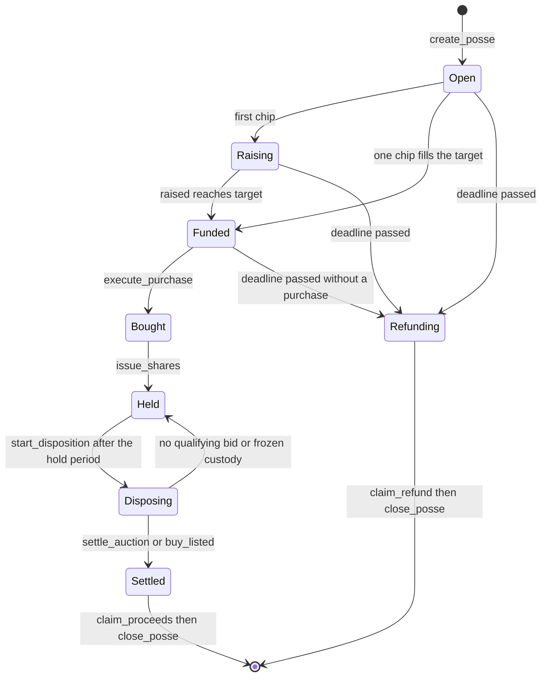
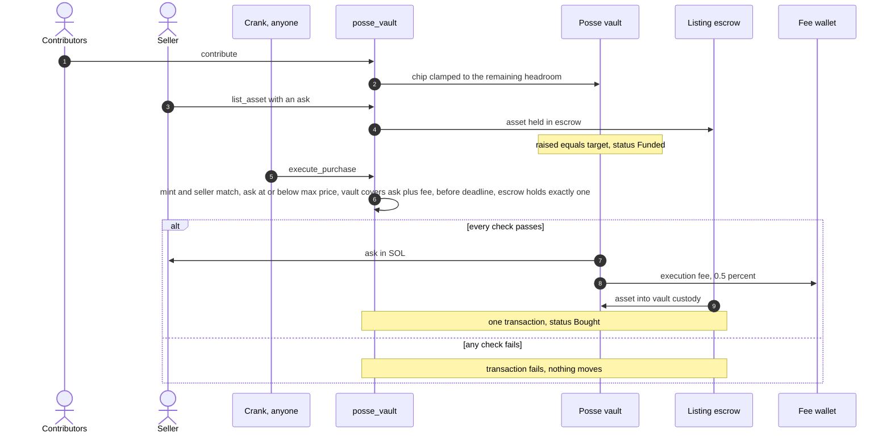
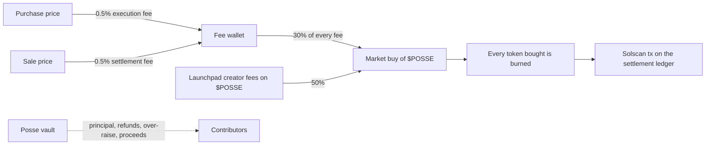
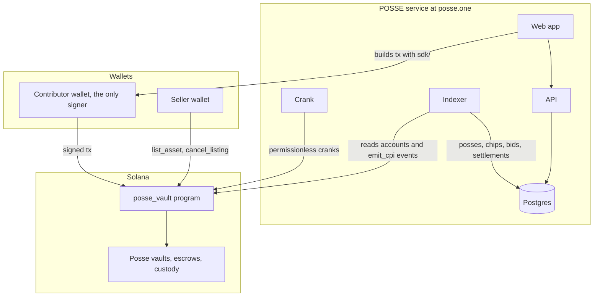

<p align="center">
  <a href="https://posse.one">
    <picture>
      <source media="(prefers-color-scheme: dark)" srcset="assets/banner-dark.png">
      <source media="(prefers-color-scheme: light)" srcset="assets/banner-light.png">
      
    </picture>
  </a>
</p>

<p align="center">
  
</p>

<h1 align="center">POSSE</h1>

<p align="center">
  <b>Conditional group purchases on Solana.</b><br>
  Buy one thing together, on terms fixed before anyone chips in. Own it by share.
</p>

<p align="center">
  <a href="https://posse.one"><b>Website</b></a>
  &nbsp;&middot;&nbsp;
  <a href="https://posse.one/app"><b>App</b></a>
  &nbsp;&middot;&nbsp;
  <a href="https://x.com/possedotone"><b>X</b></a>
  &nbsp;&middot;&nbsp;
  <a href="docs"><b>Docs</b></a>
  &nbsp;&middot;&nbsp;
  <a href="https://posse.one/proof"><b>Proof</b></a>
</p>

<p align="center">
  <a href="https://github.com/posse-labs/posse/actions/workflows/ci.yml"></a>
  <a href="https://github.com/posse-labs/posse"></a>
  <a href="https://solana.com"></a>
  <a href="https://www.anchor-lang.com"></a>
  <a href="programs/posse_vault/Cargo.toml"></a>
  <a href="tsconfig.json"></a>
  <a href="package.json"></a>
  <a href="LICENSE"></a>
</p>

<p align="center">
  <a href="#run-locally"></a>
  <a href="docs/security-model.md#mutation-testing"></a>
  <a href="https://posse.one"></a>
  <a href="https://x.com/possedotone"></a>
</p>

---

POSSE is a conditional group purchase on Solana. A group pools SOL into a vault whose terms are fixed before anyone pays in: which asset, from which seller, the most it may pay, the deadline, and how the asset is sold later. If the terms are met before the deadline, the vault executes one atomic trade. If not, everyone takes their full chip back.

This repository holds the on-chain program (`posse_vault`, Anchor), the TypeScript client used to build and read its transactions, the decoding layer of the indexer, and the test suite that runs the compiled program.

## Contents

- [Highlights](#highlights)
- [Quick start](#quick-start)
- [How it works](#how-it-works)
  - [Lifecycle](#lifecycle)
  - [Conditional vault](#conditional-vault)
  - [Delivery versus payment](#delivery-versus-payment)
  - [Refunds](#refunds)
  - [Disposition by auction or fixed price](#disposition-by-auction-or-fixed-price)
  - [Pro-rata settlement](#pro-rata-settlement)
  - [Fees and the $POSSE buyback](#fees-and-the-posse-buyback)
- [Architecture](#architecture)
- [Program address](#program-address)
- [Security model](#security-model)
- [Run locally](#run-locally)
- [Repository layout](#repository-layout)
- [Documentation](#documentation)
- [License](#license)

## Highlights

| | What it means | Where it is enforced |
|---|---|---|
| **Terms fixed at creation** | Mint, seller, maximum price, target, deadline, fees, royalty and exit rule are snapshotted into the posse. Nobody can change them afterwards, including the protocol admin. | `create_posse`, no edit instruction |
| **Atomic delivery versus payment** | The seller is paid and the asset reaches the vault in the same transaction, or nothing moves. | `execute_purchase` |
| **Never over-funded** | Each chip is clamped to `min(amount, target - raised)`. | `contribute` |
| **Full refunds** | Not bought by the deadline means every chip comes back in full, claimable once. | `expire`, `claim_refund` |
| **Permissionless cranks** | Every state-advancing instruction accepts any signer and checks only state and time. | `execute_purchase`, `issue_shares`, `expire`, `start_disposition`, `settle_auction`, `close_posse` |
| **No server co-signer** | Every user transaction is signed by the user's wallet alone. | Program account constraints |
| **Pro-rata exit** | Each contributor claims `floor(net * chip / raised)`; the sum never exceeds the pool. | `claim_proceeds`, `close_posse` |
| **Mutation tested** | Twelve invariant guards, each switched off in its own build, each caught by a scenario. | `npm run test:mutation` |

## Quick start

Requirements: Rust with the Solana toolchain (Solana CLI 3.0), Anchor CLI 0.31.1, Node.js 22. The build command selects SBF platform-tools v1.52 (Rust 1.89) for the locked dependencies.

```bash
git clone https://github.com/posse-labs/posse.git
cd posse
npm ci
npm run build
npm run typecheck
npm test
```

`npm ci` installs the TypeScript toolchain and LiteSVM, `anchor build` compiles `programs/posse_vault` into `target/deploy`, and `npm test` runs the LiteSVM program scenarios and then the client and indexer tests. Details are in [Run locally](#run-locally).

## How it works

### Lifecycle

| Step | Instruction | Status change |
|---|---|---|
| 1 | `create_posse` | terms fixed: mint, seller, max price, target, deadline, fees, royalty, exit rule |
| 2 | `contribute` | Open -> Raising -> Funded (each chip is clamped to the remaining headroom) |
| 3 | `execute_purchase` | Funded -> Bought, when the listed ask <= max price, the vault can pay ask and fee, and the deadline has not passed |
| 4 | `issue_shares` | Bought -> Held (each Contribution account is the share record) |
| 5 | `start_disposition` | Held -> Disposing (after the agreed hold period) |
| 6 | `settle_auction` / `buy_listed` | Disposing -> Settled |
| 7 | `claim_proceeds` | each contributor takes `floor(net * chip / raised)` |
| - | `expire` or the first `claim_refund` | not bought by the deadline -> Refunding, every chip returned in full |



### Conditional vault

An organizer opens a posse with `create_posse`. The posse account snapshots every term at creation: asset mint, seller, royalty recipient and rate, target, maximum price, deadline, execution and settlement fee rates, and the exit rule (auction with a reserve and duration, or a fixed price, after a hold period in days). Nothing on a posse can be changed afterwards, including by the protocol admin.

Contributors chip SOL into the posse vault, a data-less system account derived from the posse. A chip never pushes the vault above its target: the program accepts `min(amount, target - raised)`, so two chips landing at once can never over-fund the posse. Before the posse is funded a contributor may `withdraw` their chip; once it is funded, the money leaves only through the purchase or the refund path.

### Delivery versus payment

The seller deposits the asset into a program escrow with `list_asset` and sets an ask. When the posse is funded, anyone may call `execute_purchase`. The program checks, against the state of that slot, that the listing is for the posse's mint and seller, that the ask is at or below the maximum price, that the vault can pay the ask plus the execution fee, that the deadline has not passed, and that the escrow holds exactly that one asset. In one transaction it pays the seller, pays the fee wallet and moves the asset into a token account owned by the vault. If any check fails, nothing moves.



A seller who raises the ask above the maximum price cannot be paid; a seller who lowers it is paid exactly the lower ask. Any over-raise left in the vault after the purchase is returned by share through `claim_returned`.

### Refunds

If the posse has not bought by its deadline, `expire` moves it to Refunding. Contributors do not need to wait for that call: the first `claim_refund` after the deadline flips the posse by itself. Every contributor gets their entire chip back, and a contribution can be claimed only once.

### Disposition by auction or fixed price

After the hold period, anyone may call `start_disposition`.

- Auction: bids must meet the reserve and beat the standing bid by the minimum increment. The bid escrow only ever holds the current high bid; the previous bidder is refunded in the same transaction as the outbid, so there is no refund to race for. After the end time, `settle_auction` sends the asset to the winner. With no qualifying bid, the posse returns to Held and the disposition can start again.
- Fixed price: the first buyer to pay the exit price through `buy_listed` takes the asset.

On a sale the royalty is paid to the royalty recipient fixed at creation and the settlement fee to the fee wallet. The net stays in the vault for the contributors.

### Pro-rata settlement

Each contributor claims `floor(net * chip / raised)` with `claim_proceeds`, which also pays any unclaimed over-raise share and closes the contribution account. Integer floor division means the sum of payouts never exceeds the pool. After every contribution has taken its final claim, `close_posse` sends the rounding dust (less than one lamport per contributor) to the fee wallet and returns the account rent to the organizer.

### Fees and the $POSSE buyback

The program charges two fees, both set in the `Config` account and snapshotted into each posse when it is created:

| Fee | Rate | Charged on |
|---|---|---|
| Execution fee | 0.5% (50 bps) | the purchase price, at `execute_purchase` |
| Settlement fee | 0.5% (50 bps) | the sale price, at `settle_auction` or `buy_listed` |

The admin can change fees only up to `max_fee_bps` (200 bps in the deployed config), and changes reach only posses created afterwards. Principal, refunds and contributor proceeds never pass through the fee wallet.

30% of every fee that reaches the fee wallet funds market buys of $POSSE, and every token bought is burned. 50% of the launchpad creator fees on $POSSE go through the same buy-and-burn. The buyback worker runs off-chain; each buy and each burn is published with its Solscan transaction on the settlement ledger at https://posse.one.



<details>
<summary><b>Worked example</b></summary>

A posse raises 10 SOL and buys at an ask of 9 SOL.

- Execution fee: 9 * 0.5% = 0.045 SOL to the fee wallet.
- Over-raise: 10 - 9 - 0.045 = 0.955 SOL, returned to contributors by share.
- Later the asset sells at auction for 12 SOL with a 5% royalty.
- Royalty: 0.6 SOL. Settlement fee: 0.06 SOL. Net: 11.34 SOL.
- A contributor who chipped 2.5 SOL owns 25% and claims 2.835 SOL of the net plus 0.23875 SOL of the over-raise.

More in [docs/economics.md](docs/economics.md).

</details>

## Architecture



| Path | Role |
|---|---|
| `programs/posse_vault` | Anchor program. Holds all funds and enforces every rule. |
| `sdk/` | TypeScript client: PDAs, typed instruction builders, transaction assembly, account / event / error decoding, the program's lamport math, stale-safe reads. |
| `indexer/` | Event extraction and decoding used by the indexer, with stale-safe chain reads. |
| `tests/program` | Every protocol scenario against the compiled `.so` in LiteSVM. |
| `tests/sdk` | Client, decoder and stale-read tests. |

- The program is the only component that can move money. There is no server co-signer: every user transaction is signed by the user's wallet alone, and every state-advancing crank (`execute_purchase`, `issue_shares`, `expire`, `start_disposition`, `settle_auction`, `close_posse`) is permissionless. The POSSE service runs a crank so posses move on time, but anyone else can call the same instructions and the program only accepts them when the conditions hold.
- The client mirrors the program exactly: PDA seeds are little-endian like the chain, fee and share math use the same integer formulas, and every transaction the app builds stays within a 1030-byte budget so wallets can append their own instructions.
- Reads that decide something (a final status, an amount to claim, whether a transaction landed) go through `sdk/rpc`: explicit commitment, `minContextSlot` set to the highest slot already seen, a monotonic slot check, and the Clock sysvar read in the same `getMultipleAccounts` call to reject answers from a lagging node. A transaction is reported dropped only after repeated reads and blockhash expiry.
- The indexer discovers program accounts, reads their state with the same stale-safe reader, and decodes the events the program emits through `emit_cpi`. The decoder is tested byte for byte against the program IDL.

More detail: [docs/architecture.md](docs/architecture.md), [docs/protocol.md](docs/protocol.md).

## Program address

> [!NOTE]
> These are the devnet addresses. The mainnet program ID will be listed here when it is deployed.

| Program | Cluster | Address |
|---|---|---|
| posse_vault | devnet | [`629C4PESAxcsvb82LEtYtVevevEY8HZEidMPf9KcjNNx`](https://solscan.io/account/629C4PESAxcsvb82LEtYtVevevEY8HZEidMPf9KcjNNx?cluster=devnet) |
| Config PDA | devnet | [`EhMJihdqWAg3zE9CqSitFUvUhXM8oR2AgMyQ6Q5GWiLG`](https://solscan.io/account/EhMJihdqWAg3zE9CqSitFUvUhXM8oR2AgMyQ6Q5GWiLG?cluster=devnet) |

The program ID is declared in `programs/posse_vault/src/lib.rs` and in the checked-in IDL at `sdk/idl/posse_vault.json`.

## Security model

> [!WARNING]
> The program has not been through an external audit. Its invariants are covered by the LiteSVM scenario suite and by mutation testing, described below.

- Vault SOL leaves only through `execute_purchase` (seller and fee wallet), `withdraw` and `claim_refund` (the contributor's own chip), `claim_returned` and `claim_proceeds` (the contributor's share), and `close_posse` (rounding dust and the organizer's own rent). No instruction accepts a free recipient; every payee is pinned by an account constraint.
- Terms are fixed at creation. The admin can change the fee wallet and fee rates for future posses, within a hard cap, and can pause new posses and new chips. Pausing never blocks withdrawals, refunds, claims or settlement.
- Only the program's upgrade authority can create the `Config` account, so the admin seat cannot be front-run.
- The asset must be a real NFT: decimals 0, exactly one token moved, and either a supply of 1 or no mint authority.
- All arithmetic is checked integer math in lamports. The vault keeps its rent-exempt minimum; custody and escrow rent stay outside the pool.
- The only CPIs are to the System, SPL Token and Associated Token programs, and state is written before any transfer.

The twelve invariants, the attacks each one blocks, and the mutation test that proves each guard matters are in [docs/security-model.md](docs/security-model.md).

> [!IMPORTANT]
> To report a vulnerability, follow [SECURITY.md](SECURITY.md) instead of opening a public issue.

## Run locally

```bash
npm ci
npm run build
npm run typecheck
npm test
```

`npm test` runs both suites:

| Command | What it runs | Tests |
|---|---|---|
| `npm run test:program` | The compiled `target/deploy/posse_vault.so` in LiteSVM through the upgradeable loader, with real BPF execution | 20 (setup + 19 scenarios) |
| `npm run test:sdk` | Client and indexer tests | 49 |
| `npm run test:mutation` | Twelve program variants, each with one invariant guard switched off | 12 mutants, 12 caught |

<details>
<summary><b>What the program scenarios cover</b></summary>

`npm run test:program` loads `target/deploy/posse_vault.so` into LiteSVM through the upgradeable loader and runs 19 scenarios with real BPF execution: the auction and fixed-price lifecycles, refunds, price changes, unaffordable and duplicate execution, seller and asset swaps, the deadline boundary, concurrent chips, refund races, withdraw rules, failed auctions, frozen assets, admin limits, pause behavior, asset authenticity, unreachable royalty recipients, and the transaction size budget.

</details>

<details>
<summary><b>What the client and indexer tests cover</b></summary>

`npm run test:sdk` runs the client and indexer tests: decoder parity with the IDL for every account and event, event extraction from transactions, and the stale-read defenses against a node that lags, answers below `minContextSlot` or goes back in time.

</details>

<details>
<summary><b>Mutation testing</b></summary>

Mutation testing builds twelve variants of the program, each with exactly one invariant guard switched off, and requires the scenario that covers that invariant to fail:

```bash
npm run test:mutation
```

Expected result: `mutation mutants=12 caught=12 verdict=PASS`.

</details>

> [!TIP]
> After changing the program, `npm run sync-idl` copies the freshly built IDL and types into `sdk/idl`.

## Repository layout

```
.
├── Anchor.toml
├── Cargo.toml
├── assets/                     banner and mark used in this README
├── programs/posse_vault/
│   └── src/
│       ├── lib.rs              instructions and account contexts
│       ├── state.rs            accounts, seeds, constants
│       ├── events.rs           emitted events
│       ├── errors.rs           error codes
│       └── util.rs             fee, share and transfer helpers
├── sdk/
│   ├── program.ts              program id, PDAs, decoding, lamport math
│   ├── instructions.ts         typed builders for all 18 instructions
│   ├── tx.ts                   compute budget and size budget
│   ├── reader.ts               stale-safe account and signature reads
│   ├── rpc/                    minContextSlot, monotonic slot, Clock sentinel, settle
│   └── idl/                    checked-in IDL and generated types
├── indexer/
│   ├── codec.ts                account and event layouts
│   ├── decoder.ts              IDL and layout decoders
│   └── chain.ts                account discovery, reads, event extraction
├── tests/
│   ├── program/                LiteSVM scenario suite
│   └── sdk/                    client and indexer tests
├── scripts/
│   ├── mutation-control.sh     builds and checks the twelve mutants
│   └── sync-idl.sh             copies the built IDL into sdk/idl
└── docs/
    ├── architecture.md         components, stale-safe reads, indexer
    ├── protocol.md             accounts, state machine, instructions, events
    ├── security-model.md       invariants, attacks, mutation testing
    └── economics.md            fees and the $POSSE buyback
```

## Documentation

| Document | Contents |
|---|---|
| [docs/architecture.md](docs/architecture.md) | Program, client, stale-safe reads, indexer and tests |
| [docs/protocol.md](docs/protocol.md) | Accounts and seeds, state machine, every instruction, events, errors |
| [docs/security-model.md](docs/security-model.md) | The twelve invariants, attacks and the checks that stop them, mutation testing |
| [docs/economics.md](docs/economics.md) | Protocol fees, a worked example, buyback and burn |
| [CONTRIBUTING.md](CONTRIBUTING.md) | How to contribute |
| [SECURITY.md](SECURITY.md) | How to report a vulnerability |

## License

Released under the [MIT License](LICENSE).

<p align="center">
  <a href="https://posse.one">posse.one</a>
  &nbsp;&middot;&nbsp;
  <a href="https://x.com/possedotone">@possedotone</a>
</p>
