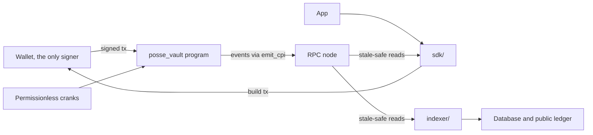

# Architecture

## On-chain program

`programs/posse_vault` is a single Anchor 0.31 program. It holds every lamport and every asset involved in a posse and is the only component that can move them. The instruction set, accounts and state machine are in [protocol.md](protocol.md).

There is no server co-signer in any instruction. A user transaction is signed by the user's wallet alone. Instructions that advance a posse on time are permissionless, so the posse does not depend on any operator being online.

## Client (`sdk/`)

- `program.ts`: program ID from the checked-in IDL, PDA derivation, raw instruction encoding with Anchor's `BorshCoder`, account, event and error decoding, and the lamport math used by the program (`feeOf`, `shareOf`, `headroomOf`, `minNextBid`). It contains no secrets and no RPC URLs and can run in a browser.
- `instructions.ts`: one typed builder per instruction. Each derives its PDAs and associated token accounts; callers pass only the keys that are real choices.
- `tx.ts`: puts `SetComputeUnitLimit` and, when given, `SetComputeUnitPrice` first, so wallets do not rewrite the message. Compute limits come from measured usage plus headroom. `assertTxBudget` keeps every transaction at or under 1030 bytes so a wallet can append its own instructions.
- `reader.ts` and `rpc/`: reads that decide or record something.

### Stale-safe reads

An RPC endpoint is often several nodes at different slots, and a plain read can return state from before a transaction that already landed. `sdk/rpc` applies four defenses:

1. Explicit commitment (`confirmed` by default).
2. `minContextSlot` set to the highest slot already observed. A node that is behind answers `-32016`; the reader waits and retries instead of accepting older state.
3. The response `context.slot` must never go backwards.
4. The Clock sysvar is read inside the same `getMultipleAccounts` call as the accounts. A node whose bank is far behind its reported slot is rejected.

`resolveSignatures` never reports a transaction as dropped from a single empty read: it requires several reads, an expired blockhash and one more read after that.

## Indexer (`indexer/`)

- `chain.ts`: discovers program accounts with `getProgramAccounts` filtered by discriminator, reads their data through the stale-safe reader, pages signatures for the program, and extracts events from each transaction. Events are taken from the program's own `emit_cpi` inner instructions; if a transaction has none, `Program data:` log lines inside the program's invocation are used.
- `codec.ts`: account and event layouts with Anchor discriminators. Accounts are read by known prefix, so appended fields never break the reader.
- `decoder.ts`: one interface over two decoders, the layout codec and Anchor's `BorshCoder` from the IDL, both normalized to the same shapes. The tests encode every account and event and require both decoders to agree, which catches any drift between the program and the indexer.

The indexer service built on these modules writes posses, contributions, bids and settlements into a database and serves the public settlement ledger at https://posse.one.

## Tests

`tests/program/chain.ts` deploys the compiled `.so` into LiteSVM through the upgradeable loader and writes a test upgrade authority into ProgramData, so `initialize_config` runs exactly as on a real cluster. `tests/program/scenarios.ts` holds the protocol scenarios, written against a small chain interface. Each scenario checks balances, account bytes and events after every step and includes the rejected cases next to the successful ones.
