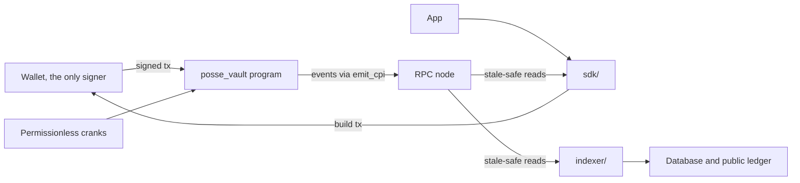

# Architecture

## On-chain program

`programs/posse_vault` is a single Anchor 0.31 program. It holds every lamport and every asset involved in a posse and is the only component that can move them. The instruction set, accounts and state machine are in [protocol.md](protocol.md).

There is no server co-signer in any instruction. A user transaction is signed by the user's wallet alone. Instructions that advance a posse on time are permissionless, so the posse does not depend on any operator being online.

