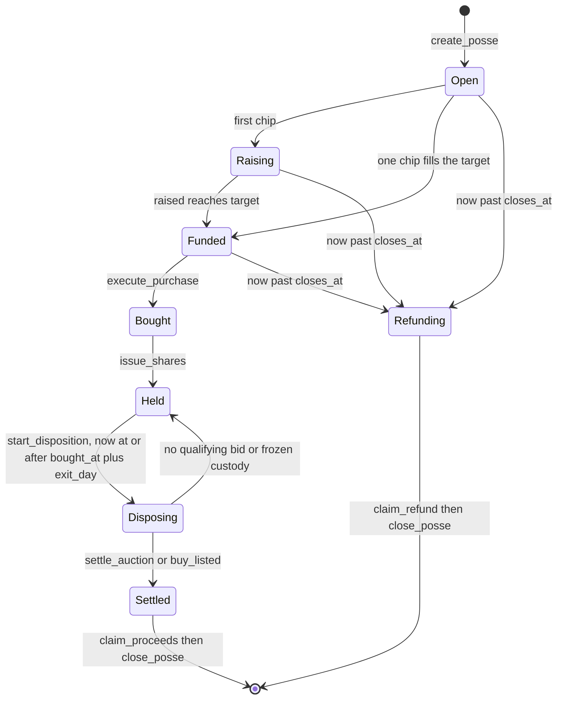

# Protocol

All amounts on chain are lamports (`u64`). All times are the chain Clock `unix_timestamp`. Numbers inside PDA seeds are little-endian. Discriminators follow Anchor: `sha256("account:<Name>")[..8]`, `sha256("event:<Name>")[..8]`, `sha256("global:<snake_name>")[..8]`.

## Accounts

| Account | Seeds | Purpose |
|---|---|---|
| `Config` | `["config"]` | Admin, fee wallet, execution and settlement fee rates, fee cap, pause flag. One per program. |
| `Posse` | `["posse", organizer, nonce]` | The terms of one group purchase and its progress. |
| Vault | `["vault", posse]` | System account with no data that holds the pooled SOL. |
| Custody | ATA of (vault, mint) | Holds the asset after the purchase. |
| `Contribution` | `["contribution", posse, contributor]` | One per contributor per posse. The share record. |
| `Listing` | `["listing", seller, mint]` | A seller's deposited asset and ask. |
| Listing escrow | ATA of (listing, mint) | Holds the listed asset until it is bought or withdrawn. |
| `Disposition` | `["disposition", posse]` | The exit sale: kind, timing, reserve, high bid, settlement amounts. |
| Bid escrow | `["bid-escrow", posse]` | System account holding only the current high bid. |

Every account with data carries a reserved tail so fields can be appended in an upgrade without moving existing ones.

### Posse terms fixed at creation

`mint`, `seller`, `royalty_recipient`, `royalty_bps`, `target_lamports`, `max_price_lamports`, `closes_at`, `exit_kind` (0 auction, 1 fixed price), `exit_day` (hold period in days), `exit_price_lamports` (auction reserve or fixed price, at least 0.01 SOL), `exit_hours` (auction length, 1 to 720), plus `fee_bps` and `settle_fee_bps` copied from `Config`.

Share is never stored. While raising it is `chip / target`; after a purchase it is `chip / raised`, computed at claim time.

## State machine

| Status | Value |
|---|---|
| Open | 0 |
| Raising | 1 |
| Funded | 2 |
| Bought | 3 |
| Held | 4 |
| Disposing | 5 |
| Settled | 6 |
| Refunding | 7 |

## Instructions

| Instruction | Signer | Preconditions | Effect |
|---|---|---|---|
| `initialize_config` | program upgrade authority | Config does not exist; fees <= `max_fee_bps` <= 1000 | Creates Config. |
| `update_config` | Config admin | new fees <= `max_fee_bps` | Fee wallet, fee rates, admin, pause. Existing posses keep their own fees. |
| `create_posse` | organizer | not paused; mint decimals 0; target and max price > 0; deadline in the future; valid exit terms; royalty <= 10000 bps | Creates the posse and its vault, status Open. |
| `contribute` | contributor | Open or Raising; not past the deadline; headroom > 0; not paused | Accepts `min(amount, headroom)`. Raised reaching the target sets Funded. |
| `withdraw` | contributor | Open or Raising | Returns the full chip and closes the contribution. |
| `list_asset` | seller | seller holds the asset; NFT checks pass | Moves the asset into the listing escrow with an ask. |
| `cancel_listing` | seller | listing open | Returns the asset and closes the listing. |
| `execute_purchase` | anyone | Funded; not past the deadline; listing open for the posse's mint and seller; ask <= max price; raised >= ask + fee; escrow holds exactly one | Pays the seller and fee wallet, moves the asset to custody, records the over-raise. Status Bought. |
| `issue_shares` | anyone | Bought | Status Held. |
| `expire` | anyone | Open, Raising or Funded; past the deadline | Status Refunding. |
| `start_disposition` | anyone | Held; hold period over | Creates the disposition. Status Disposing. |
| `bid` | bidder | auction live; amount >= reserve; amount >= high bid + max(reserve / 100, 0.01 SOL) | Escrows the bid and refunds the previous high bidder in the same transaction. |
| `settle_auction` | anyone | auction ended; not settled | Winning bid: asset to the winner, royalty and settlement fee paid, net left in the vault, status Settled. No bid, or a frozen custody account: the bid is refunded and the posse returns to Held. |
| `buy_listed` | buyer | fixed-price disposition live | Buyer pays the exit price and takes the asset. Royalty and fee paid, status Settled. |
| `claim_returned` | contributor | Bought, Held, Disposing or Settled; over-raise > 0; not yet claimed | Pays `floor(returned * chip / raised)`. |
| `claim_proceeds` | contributor | Settled; final claim not taken | Pays `floor(net * chip / raised)` plus any unclaimed over-raise share, closes the contribution. |
| `claim_refund` | contributor | Refunding, or past the deadline without a purchase | Pays the full chip, closes the contribution. The first call after the deadline sets Refunding. |
| `close_posse` | anyone | Settled or Refunding; every contribution took its final claim | Dust to the fee wallet, rent to the organizer and the disposition rent payer. |

A payout too small to make an empty recipient account rent-exempt is skipped rather than failing the whole transaction; that amount stays in the vault for the contributors.

## Events

Every instruction that changes state emits an event through `emit_cpi`, so indexers can read events from inner instructions even when logs are truncated:

`ConfigUpdated`, `PosseCreated`, `ChippedIn`, `Funded`, `Withdrew`, `AssetListed`, `ListingCancelled`, `Purchased`, `SharesIssued`, `Expired`, `DispositionStarted`, `BidPlaced`, `Settled`, `DispositionFailed`, `ReturnedClaimed`, `ProceedsClaimed`, `RefundClaimed`, `PosseClosed`.

